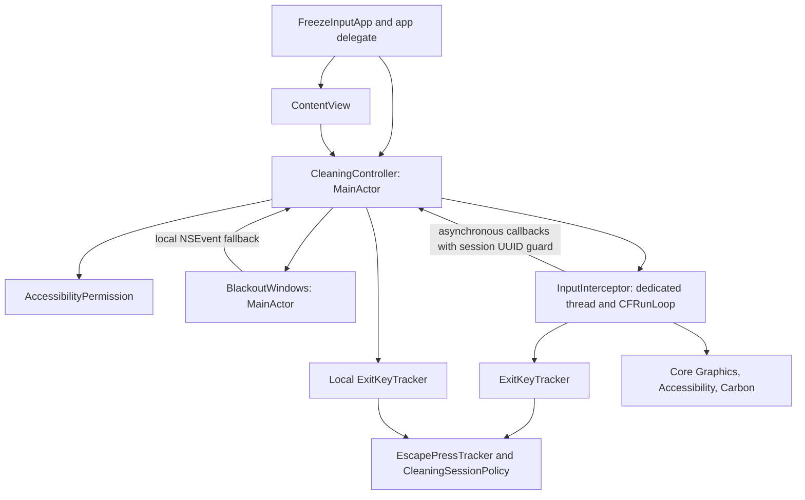

# Freeze Input — Technical Documentation

This document describes the current working-tree implementation, including existing uncommitted source files, as inspected on 2026-10-15. The [README](README.md) contains developer setup and usage. Source implementation, test coverage, and runtime validation are distinct forms of evidence.

## Evidence and status

| Status | Meaning and current scope |
| --- | --- |
| **Implemented** | Source exists and is wired into the app entry point, session controller, or worker's normal path |
| **Test-covered** | `Tests/LogicChecks.swift` contains assertions for the identified logic; this does not claim execution or success |
| **Verified in this task** | Read-only source/configuration inspection, `plutil -lint`, documentation checks, whitespace checks, and preservation of non-document files |
| **Externally unverified** | Live TCC/Accessibility behavior, event delivery, physical input suppression, displays, cursor/presentation restoration, emergency recovery, and signing/distribution |
| **Experimental / Inactive** | Visible inspection mode is implemented but disabled by the current source constant; `AccessibilityPermission.openSettings()` exists without a caller in the normal UI |
| **Planned / Not implemented** | Only the recommendations in Future development; no release commitment or available feature is implied |

No `xcodebuild`, Xcode Build/Test, standalone logic-check execution, Simulator operation, service startup, signing, or hardware test was performed in this task. Build/Test and runtime checks are to be performed manually.

## System overview

The app creates a local, foreground cleaning session. SwiftUI presents instructions and permission state. A main-actor controller validates prerequisites, starts a dedicated event-tap thread, and only then asks AppKit to show overlays. The worker suppresses selected keyboard/pointer events and independently monitors health. AppKit provides a local exit/gesture fallback for events delivered to the app.

Normal mode has `CleaningController.showsBlackScreen = true`. The alternative `false` branch keeps the display/cursor visible and does not change app presentation, but still installs real taps and local monitors. It is a source-only diagnostic mode, not a simulated or permission-free path.

No networking, provider adapters, backend, persistence layer, database, cloud sync, or user-document processing exists in the inspected source.

## Architecture and ownership

`FreezeInputApp` is the composition root: it adopts `FreezeInputAppDelegate`, retains `CleaningController.shared` with `@StateObject`, and injects it into `ContentView` as an `@ObservedObject`. There is no dependency-injection framework, service protocol layer, or mock provider configuration. Concrete dependencies are created directly.

| Component / file under `Freeze Input/` | Responsibility, interface, and ownership |
| --- | --- |
| `MyApp.swift`: `FreezeInputApp` | Owns the single named SwiftUI window and controller observation; removes the New command group and fixes content-size resizing |
| `MyApp.swift`: `FreezeInputAppDelegate` | Calls `shutdown()` during termination; last-window closure terminates only when the controller is not busy |
| `ContentView.swift`: `ContentView` | Renders permission, instructions, start availability, messages, and pending-release state; calls controller actions |
| `CleaningController.swift`: `CleaningController` | Owns session UUID, current interceptor, blackout manager, lifecycle observers, main timers, and local exit-key state |
| `AccessibilityPermission.swift`: `AccessibilityPermission` | Wraps trust checks and explicit prompt; contains an inactive Settings URL helper |
| `BlackoutWindows.swift`: `BlackoutWindows` | Owns windows, local monitor, cursor hide accounting, and saved presentation options; exposes `show(...) -> Bool` and `hide()` |
| `BlackoutWindows.swift`: `BlackWindow`, `BlackView` | Key-capable borderless window and opaque black view; view accepts first responder and overrides key/gesture handlers without actions |
| `InputInterceptor.swift`: `InputInterceptor` | Owns two taps, sources, worker timer/run loop, callbacks, cancellation, heartbeat, release drainage, and recovery acknowledgment |
| `InputInterceptor.swift`: `ExitKeyTracker` | Shared scalar/CGEvent exit decoder; inputs are key code, repeat flag, modifiers, event direction, and supplied uptime |
| `InputInterceptor.swift`: `InputTapRequirements` | Pure metadata predicate for process, location, enablement, and required keyboard mask |
| `EscapePressTracker.swift` | `EscapePressTracker`, `CleaningSessionPolicy`, and user-facing `CleaningExitReason` values |

`Freeze Input.xcodeproj/project.pbxproj` uses a file-system-synchronized root group for `Freeze Input/`; empty explicit Sources/Resources lists do not mean the app source is inactive. `Tests/` is outside that synchronized group and has no test target. The asset catalog contains metadata and an accent-color entry. Workspace data refers to the project itself. No scripts, CI, manifests, lockfiles, environment examples, standalone entitlement files, or additional documentation existed beyond the original README.

### Concurrency and lifetime

App/UI and window ownership are main-actor isolated. `InputInterceptor` is explicitly `nonisolated` and `@unchecked Sendable`; correctness relies on its manual confinement and locking, not compiler-proven safety. The dedicated `Thread` retains the interceptor until its run function completes, keeping the unmanaged callback context valid through tap invalidation.

Event-sequence and release-drain state live on the worker run loop. Resource publication, cancellation, heartbeat, and recovery acknowledgment use `NSLock`. Requests from the local monitor use `CFRunLoopPerformBlock` and wake the worker; callbacks enqueue UI work asynchronously rather than synchronously blocking on the main queue. Controller callbacks capture a session UUID and ignore stale notifications after stop/restart.

The controller's 0.5-second heartbeat timer runs in main-run-loop common modes and also refreshes permission. The worker runs in explicit default mode, with bounded 0.25-second run-loop iterations for cancellation. Controller `shutdown()` removes observers and invalidates the heartbeat timer; session cleanup is idempotent.

## Data flow and lifecycle

### Startup

1. `ContentView.onAppear`, app activation, and the heartbeat refresh Accessibility state. **Request Access** invokes `AXIsProcessTrustedWithOptions` with the prompt option; it does not grant trust.
2. `start()` rejects busy sessions, missing Accessibility trust, or Secure Event Input. It creates a UUID and interceptor, marks the controller busy, then waits up to two seconds for worker readiness.
3. The worker rechecks trust/Secure Event Input and creates two active `.cgSessionEventTap` taps at `.headInsertEventTap` with `.defaultTap` options: one for key-down/up and another for modifier/pointer events. Each receives a run-loop source.
4. `CGGetEventTapList` is queried twice, allocating the initial count plus 16 entries. Errors or a returned count beyond capacity reject startup. `InputTapRequirements` requires an enabled session tap from this process containing both key-down and key-up mask bits. It does not match a unique tap identifier, and it does not prove physical delivery.
5. The worker installs its 50 ms health timer and sources, publishes resources under lock, enables taps unless canceled, and signals readiness. Success requires two published taps and no cancellation; enablement failure cancels startup.
6. The controller rechecks trust, Secure Event Input, and app activity before `blackout.show(...)`. Failure calls `stop()` rather than intentionally leaving an overlay. A successful session sets `isCleaning` and installs a 50 ms local safety timer.

The two-second semaphore wait blocks the caller during startup. No asynchronous startup UI or automatic retry/backoff exists. `failureDescription` supplies startup diagnostics; some failure paths use a generic message.

### Event filtering and exit

While active, the callback returns `nil` for selected ordinary events, suppressing their propagation. The masks include key-down/up; flags changed; left/right/other mouse down/up; mouse movement and drags; and scroll wheel. It does not parse typed strings or store input content. It reads key codes, repeat flags, and modifiers for exit decisions.

The local monitor consumes supported gesture, magnify, smart magnify, rotate, swipe, begin/end gesture, pressure, direct-touch, and keyboard/modifier events delivered to this app. In normal mode it consumes monitored key/modifier events. In visible inspection mode it allows ordinary keys/modifiers through while consuming Esc and the backup-related Q events, so ordinary local keyboard consumption does not conceal a failed tap.

On worker `finish(...)`, general filtering stops immediately unless an exit key needs drainage; `onExit` queues visual cleanup. `onFinished` clears busy state and the controller's interceptor reference after worker resource cleanup. During backup drainage, unrelated input passes through. Foreground loss during this already visually finished state is ignored so it does not interrupt the release filter; sleep/display changes can still stop it.

### Overlay and local safety path

Normal `BlackoutWindows.show` requires at least one screen, saves presentation options, applies `.hideDock`, `.hideMenuBar`, and `.disableProcessSwitching`, and activates the app. It creates opaque, shadowless, borderless `.screenSaver`-level windows with `.canJoinAllSpaces`, `.fullScreenAuxiliary`, and `.stationary` behavior. The first becomes key; the cursor is hidden once. There is no native full-screen Space transition, countdown, or overlay control.

`hide()` removes the local monitor, closes owned windows, balances the cursor hide, and restores saved presentation options. Display changes end the session rather than dynamically rebuilding overlays.

Local keyboard decoding requests worker exit and records a pending request. A local key-up can acknowledge release through the worker queue. If the request remains pending for at least 250 ms, the main safety timer calls direct controller `stop()`. The local three-minute deadline also calls direct `stop()`; unlike a pending keyboard exit, it does not first request worker drainage. Direct stop disables published taps synchronously, clears the session UUID/state, and closes overlays. If the worker is stalled, this fallback cannot guarantee exit-key drainage.

### Abnormal stop and recovery

Lifecycle notifications stop busy sessions for app deactivation, display changes, system/display sleep, session resignation, and system/display wake. Cleaning never automatically resumes. Permission loss detected on the main side also calls direct stop.

Every 50 ms, a responsive worker checks Accessibility, Secure Event Input, tap count/enablement, then drainage deadline or heartbeat/session expiry. Tap timeout/user-disable notifications cause safe exit rather than repeated re-enablement. `stop()` disables published taps and stops/wakes the run loop; the worker removes sources/timer, invalidates ports, and reports completion.

Each first worker `finish(...)` queues a main-queue recovery acknowledgment behind its queued visual cleanup and schedules an independent global-queue check two seconds later. If acknowledgment has not run, `Darwin._exit(EXIT_FAILURE)` terminates the process, bypassing normal AppKit cleanup. This relies on the OS to remove owned windows/presentation; cursor restoration is externally unverified. Startup failures and direct controller stop do not themselves call this worker `finish` recovery path. No in-process watchdog guarantees recovery when all relevant threads or the OS are stalled.

## Data models and state

| State/model | Meaning and storage boundary |
| --- | --- |
| `isCleaning` | Main-actor published flag for active visual/filtering session |
| `isBusy` | Startup/session/drain occupancy; stays true during ordinary backup-key drainage |
| `hasPermission`, `message` | Published trust snapshot and optional user-facing diagnostic |
| `sessionID` | In-memory UUID for stale-callback rejection; cleared before direct cleanup |
| `EscapePressTracker` | Completed count, first press uptime, and pressed flag; no key content |
| `ExitKeyTracker` | Owns Esc tracker and produces `(reason, releaseKey)` decisions |
| `CleaningExitReason` | Sendable string-backed reasons used directly as English UI messages |
| `CleaningSessionPolicy` | Static duration values and pure expiry predicates |
| Worker state | Tap/run-loop references, cancellation, heartbeat uptime, release key/deadline, local-release set, and recovery flags |
| Window state | Owned windows, monitor token, cursor flag, and previous presentation options |

There are no DTO/provider boundaries, cache, schema version, migration, Keychain, database, document save, or cloud storage paths. App authorization is managed externally by macOS TCC. Session state is ephemeral and is not restored after termination or sleep. Time comparisons use monotonic system uptime; there is no timezone/session-calendar logic. The run-loop timer's initial schedule uses `CFAbsoluteTimeGetCurrent`, while policy decisions use uptime.

## Important logic and edge cases

### Esc sequence

`EscapePressTracker.requiredPresses = 5` and `sequenceDuration = 3`. The interval starts at the first accepted key-down, and the fifth key-up must arrive no more than three seconds later. Expiry uses `elapsed > 3`, so the exact three-second boundary is accepted. Expiry is processed when the next key event arrives; no timer exits a session merely because an Esc sequence timed out.

Only complete down/up pairs count. Repeats, duplicate downs, orphan ups, and duplicate ups do not add presses. Another key-down or modifier-change event resets the sequence. A long hold cannot produce five presses. A successful sequence resets tracker state and exits on the fifth release, consuming that event without an Esc tail-drain phase. Worker and local fallback use the same decoder implementation but maintain separate tracker instances.

### Backup shortcut and release drainage

The decoder uses virtual key code 12 and requires Control, Option, and Command on a non-repeat key-down. The `contains` check allows additional modifiers; it is not exact-modifier equality. Esc uses key code 53. These are key-code-based decisions, not localized character matching.

Backup exit supplies release key 12, allowing general input while swallowing that key's repeats/release. Drainage stops on its release, an acknowledged local release, or ten seconds. A held key can send ordinary events after grace expiry. Abnormal stops bypass drainage. Session restart is prevented by `isBusy` while the normal drain remains pending.

### Deadlines

| Mechanism | Source value / rule |
| --- | --- |
| Worker startup wait | 2 seconds |
| Worker health tick | 0.05 seconds |
| Main heartbeat | 0.5 seconds, common modes |
| UI unresponsive threshold | At least 3 seconds since last heartbeat |
| Session maximum | At least 180 seconds; independently checked on worker and main side with different start timestamps |
| Main local safety tick | 0.05 seconds, common modes |
| Pending local keyboard exit | Direct fallback after at least 0.25 seconds |
| Backup release grace | 10 seconds |
| Main cleanup acknowledgment fallback | Global queue check after 2 seconds |

These are scheduling policies rather than hard real-time guarantees. No warm-up, deduplication pipeline, rate limiter, retry budget, cache invalidation, or conflict-resolution subsystem exists; duplicate key-event handling is confined to the sequence tracker.

## External dependencies and configuration

Only system SDK frameworks are imported: SwiftUI (UI/composition), AppKit (application/window/events), Combine (observable state), Foundation (threading/time/state), ApplicationServices and Core Graphics (trust/taps/events), Carbon (Secure Event Input), and Darwin (process identity/emergency exit). `CoreGraphics` is explicitly imported by the standalone checks. Framework versions follow the selected Apple SDK; none is separately pinned.

The app uses public Apple APIs, not an unofficial remote endpoint. `AccessibilityPermission.openSettings()` constructs an `x-apple.systempreferences` Accessibility URL, but the current UI does not call it. This deep link's future OS behavior is unverified and it is not a network backend.

| Configuration | Current declaration / implication |
| --- | --- |
| Target/product | One application target named `Freeze Input`; output reference `Freeze Input.app`; `PRODUCT_NAME = $(TARGET_NAME)` |
| Legacy metadata | `productName = MyApp` and a user scheme metadata entry remain; they do not define a second target |
| Configurations | Debug and Release; configuration-list default is Release |
| Platform/SDK | `SUPPORTED_PLATFORMS = macosx`, `SDKROOT = auto`, macOS deployment target 14.0, Catalyst disabled |
| Toolchain | Swift language mode 5.0; no pinned compiler/Xcode version; project format 90, creation metadata 26.3, upgrade metadata 2700 |
| Concurrency | Approachable concurrency enabled; default actor isolation MainActor; member import visibility upcoming feature enabled |
| App identity | Display name `Freeze Input`; bundle ID `com.sunny.freeze-input`; marketing version 1.0; build version 20261014 |
| Signing | Automatic signing and a preconfigured development team; machine/account portability is not established |
| Sandbox | `ENABLE_APP_SANDBOX = NO`; `ENABLE_USER_SELECTED_FILES = readonly` does not establish a file-selection feature or an enabled sandbox |
| Other settings | Generated Info.plist, app-group registration setting enabled, previews/localization extraction enabled; no source app-group storage or declared group entitlement file |
| Diagnostic flag | `CleaningController.showsBlackScreen = true`; source-only false branch requires editing/rebuilding, not an environment variable |
| Schemes | No actual `.xcscheme` file; user management metadata names entries but does not define Run/Test actions |

Unused iOS/iPadOS scene/orientation settings and other platform deployment values remain in the project. The actual supported-platform declaration and AppKit/Carbon implementation are macOS-only evidence; those unused settings do not establish mobile support. No explicit architecture list or exact minimum Xcode version is declared.

There is no `.xcconfig`, package manifest, lockfile, external SDK setup, backend config, environment variable lookup, API key, or secret-file requirement in the inspected implementation. No certificates/private keys were read or copied for this task.

## Error handling and logging

Startup returns `Bool` plus a lock-protected failure description. User-facing errors cover missing trust/Secure Event Input, tap/source creation failure, ineffective keyboard coverage, and a generic unsafe-start condition. Runtime reasons distinguish permission loss, tap failure, safety expiry, heartbeat failure, lifecycle changes, and user exit. There is no structured error protocol, automatic retry/backoff, or persistent error history; the user manually resolves prerequisites and retries.

There is no app logging/telemetry pipeline or input-content logging. The standalone check executable prints a PASS summary only after assertions complete. No network error redaction path is needed because no network/credential flow exists. Cancellation is an idempotent tap-disable/run-loop-stop operation; UUID guards protect UI from late worker callbacks. No automatic re-enable loop masks a tap disabled by the OS.

## Security and privacy

Input interception requires Accessibility trust and a foreground session. The source reads only event metadata needed to filter and identify exits, without converting it into typed text, replaying events, writing it to disk, or uploading it. This is source inspection evidence, not a live traffic or OS privacy audit. There is no root privilege request, private API integration, kernel extension, or SIP modification in the repository.

The app is explicitly unsandboxed. The repository does not demonstrate App Store eligibility or a signed/notarized release. No authentication, token storage, Keychain, TLS/pinning, database encryption, WebView, App Attest, APNs, cloud sync, or remote execution is implemented. No credentials are needed for normal source-level logic checks; signing and OS authorization have separate external boundaries.

Safety is fail-closed at startup: unsuccessful trust checks, secure input, missing effective keyboard coverage, or failed tap enablement prevent entry into the normal overlay session. Runtime anomalies favor releasing interception and restoring the UI rather than retrying silently. These choices reduce risk without proving all physical input can be blocked. Force Quit is not disabled through presentation options, but its keyboard shortcut may be intercepted; use backup exit or wait for safety release.

## Testing

`Tests/LogicChecks.swift` is an `@main` executable using Foundation/CoreGraphics and `precondition`, not XCTest or Swift Testing. It covers:

- Five complete Esc pairs, the exact three-second boundary, timeout just beyond it, state reset, duplicate/orphan events, repeats, and long holds.
- CGEvent exit decoding and the scalar path used by the local fallback.
- Sequence reset by another key-down or modifier change; backup required modifiers, wrong key, repeat, and key-up rejection.
- Keyboard metadata acceptance/rejection for empty lists, partial/mouse-only masks, disabled taps, other processes, and wrong tap locations.
- Pure 180-second session and three-second heartbeat predicates immediately before and at their thresholds.

The [README standalone command](README.md#development-and-validation) compiles two production files plus the check file. It constructs in-memory `CGEvent` objects, does not post events, and does not call the live interceptor startup. It needs a suitable macOS SDK/compiler and must be run without disabling assertions. It does not reproduce the full app target's compilation settings.

**Test-covered does not mean verified:** No check executable, app build, test, or static analyzer was run in this task. There is no automated coverage for controller/window lifecycle, live taps, release-drain concurrency, startup races, emergency termination, cursor balancing, or OS gesture behavior. No CI or checked-in test scheme exists.

### Manual runtime validation

The following is an unexecuted hardware checklist, not a report of passing results:

- Permission: first launch, denial, later grant, active revocation, rebuilt-app identity changes, and manual re-add/relaunch.
- Unsafe startup: missing permission or Secure Event Input must leave no black overlay or hidden cursor and preserve usable ordinary input.
- Displays: black coverage, menu bar/Dock, notch, scaling, mirroring, multiple screens, Spaces, an existing full-screen app, and hot-plug exit.
- Input: internal/external keyboards and pointers; left/right/other buttons, movement, drags, and scrolling. Check actual event suppression; pointer position alone is insufficient evidence.
- Esc: one to four presses do not exit; fifth release within three seconds does; exact deadline, expiry, repeats, long hold, and resets work; no stray Esc reaches another app. Check any audible key feedback without assuming its cause.
- Backup: exit on required modifier/Q key-down, no stray Q, release/repeat drainage, grace expiry, and restart availability.
- No-input timeout: the three-minute deadline releases filtering and overlays without receiving events.
- Gestures: test AppKit gestures separately from Mission Control/Spaces/Show Desktop and record system bypasses.
- Lifecycle: sleep/wake, lid close/open, lock/user switch, deactivation, display changes, normal Quit, and Force Quit; verify no automatic resumption.
- Failure recovery: tap timeout/disablement, main-thread-only stall for heartbeat release and subsequent emergency termination, blocked cleanup during Esc/backup exit, and worker-stall local fallback. Pausing all threads in a debugger does not validate independent watchdog behavior.
- Repeated sessions: no residual windows, cursor hide imbalance, monitors, taps, or threads.

If keyboard exit fails after an Xcode launch, report startup/status messages and whether the current three-minute timeout works. A successful visual timeout does not prove the keyboard callback path. If effective keyboard access is rejected, manually reauthorize the exact running app and relaunch; do not treat unrelated permissions as a substitute for diagnosis. Prior README anecdotes about an older five-minute timeout are not current-version evidence and are not retained as verified results.

## Known limitations and technical debt

- Public session taps and local monitors do not disable hardware or guarantee interception of system-reserved events. Secure Event Input can prevent keyboard delivery, and a brief notification/polling gap can exist before abnormal-state cleanup.
- The metadata predicate accepts any qualifying enabled tap from this PID at the required location, rather than identifying the newly created keyboard tap. Its purpose is startup screening, not proof of end-to-end delivery.
- `@unchecked Sendable`, unmanaged callback context, manual locks, two independent exit trackers, and direct fallback cleanup require careful concurrency review. Current logic checks do not cover these lifetimes or races.
- The startup semaphore can block the UI for up to two seconds. UI heartbeat checks and cleanup acknowledgment are scheduled work, not hard recovery guarantees.
- A fully stalled worker depends partly on macOS disabling an unresponsive tap. A fully stalled process cannot execute its own cleanup. Emergency `_exit` deliberately skips normal restoration and needs physical verification.
- Source-only inspection mode is inaccessible through the UI and still intercepts real input. Foreground loss ends either mode.
- User-specific workspace/scheme metadata and automatic signing configuration reduce portability. No shared scheme, pinned toolchain, CI, release script, notarization process, or project-wide license is provided.
- Stale `MyApp` metadata and unused non-macOS settings can confuse setup but do not represent additional implemented platforms.

## Design decisions

- Separate keyboard/pointer taps plus keyboard-mask validation guard against treating a mouse-capable tap as sufficient keyboard access. The extra metadata query increases startup complexity without proving physical delivery.
- Overlays are created only after worker startup and a second prerequisite check. Failure paths favor canceling cleaning rather than showing a black screen without validated filter setup.
- Dedicated worker-run-loop ownership keeps event callbacks short and avoids synchronous UI dispatch. Explicit manual synchronization trades compiler enforcement for cross-thread control.
- Five complete Esc pairs provide a deliberate release-based exit without needing an Esc tail filter; backup Q requires bounded drainage to avoid leaking its release/repeats.
- Layered worker/main deadlines, heartbeat checks, lifecycle stops, and emergency termination favor releasing input on failure. None is presented as a universal OS-failure guarantee.
- Directly composed concrete components keep this small local app simple; pure sequence/policy/metadata helpers provide existing test extension points. There is no provider-neutral adapter layer because no providers exist.
- In-memory-only state avoids storing input history or recovering an active cleaning session after restart. No network dependency is required.

## Future development

The following are **Planned / Not implemented recommendations**, grounded in current extension points:

- Add tests around `CleaningController` session transitions and `InputInterceptor` drainage/cancellation ownership, preserving main-actor window ownership and worker serialization. Any abstractions should keep event content ephemeral and never post real events in offline tests.
- Add a portable shared scheme and toolchain/CI documentation after confirming supported Xcode versions. Keep pure logic checks distinct from permission-dependent hardware validation.
- Consider asynchronous startup around the existing readiness boundary to reduce UI blocking, while preserving cancellation, UUID stale-result protection, and the rule that overlays appear only after successful startup.
- If visible inspection becomes a supported setting, connect it through controller configuration with clear user-facing behavior; retain real permission checks, exit paths, and safety limits.
- Define a project license and distribution/signing process separately before publication. Do not infer entitlements, App Store eligibility, or broader system access from current settings.

No new permission, privileged helper, external provider, or persistent input capture is implied by these recommendations.
